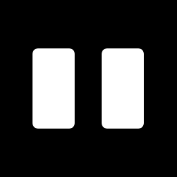

<p align="center">
  
</p>

<h1 align="center">Nib: a dark little notch for Windows 11</h1>

<p align="center">
  <a href="https://github.com/msz0/nib/releases/latest/download/Nib-Setup.exe"><b>Download Nib for Windows</b></a>
</p>

<div align="center">

<div align="center">

<div align="center">

#  Nib

### Your Little Desktop Companion for Windows 11

**A customizable desktop island with an animated cat, productivity tools, media controls, and system monitoring.**


### [⬇️ Download Nib for Windows](https://github.com/msz0/nib/releases)

**[Features](#-features) • [Installation](#️-installation) • [User Guide](#-user-guide) • [Troubleshooting](#️-troubleshooting)**

---

### Small on your screen. Big on personality.

</div>

## 🌟 Meet Nib

**Nib transforms the top of your Windows desktop into a smart, interactive island.**

Nib combines productivity tools, media controls, system monitoring, and a customizable animated cat companion in one convenient interface.

When you're not using it, Nib stays collapsed into a small pill at the top of your screen.

Move your mouse over it, and your desktop companion comes to life.

---

## ✨ Features

### 🐱 Cat Companion Studio

Make your desktop companion truly yours.

- 🎨 **Custom Fur Colors** — Choose presets or your own HEX color.
- 👀 **Custom Eye Colors** — Personalize your cat's eyes.
- 😺 **Five Personalities** — Friendly, Playful, Sleepy, Grumpy, and Minimal.
- 🎩 **Accessories** — Headphones, glasses, bows, and crowns.
- 💖 **Interactive Petting** — Click your cat for happy reactions.
- 💤 **Sleep Mode** — Your cat can sleep after inactivity.
- ✨ **Animated Expressions** — Blinking, eye tracking, ear movements, and reactions.
- 🌙 **Theme Support** — Cat appearance adapts to Dark, Light, and Night modes.

Customize your cat under:

`Settings → Island → Cat appearance`

---

### 🖥️ Smart Desktop Island

A small desktop companion that expands when you need it.

- Automatic expansion and folding
- Hover-to-open and click-to-open options
- Floating and attached styles
- Adjustable transparency
- Customizable island size
- Custom positioning
- Position locking
- Dark, Light, and Night themes

The resting island can display:

`Clock • CPU • RAM • GPU Temperature • Battery • Upcoming Events`

---

### 🧰 Screen Tools

Useful desktop utilities accessible directly from Nib.

| Tool | Description |
|---|---|
| 📸 Text OCR | Extract text from screenshots using Tesseract |
| ✏️ Live Draw | Draw directly over your desktop |
| 🎨 HEX Picker | Pick and copy colors from your screen |

**OCR features:**

- Windows Snipping Tool integration
- Automatic screenshot import
- Offline text extraction
- Editable recognized text
- Copy extracted text
- Import existing images

**Live Draw features:**

- Transparent desktop overlay
- Freehand drawing
- Pen color selection
- Undo and Clear
- Escape to exit

---

### 🎙️ Voice Memo

Capture quick voice notes without leaving your workspace.

- Select microphone input
- Select speaker output
- Record audio
- Play recordings inside Nib
- Stop playback
- Export recordings
- Delete recordings
- Local recording storage

Microphone processing options include noise suppression and echo cancellation when supported.

---

### 📊 System & GPU Monitoring

Monitor your PC directly from your desktop island.

| Metric | Availability |
|---|---|
| CPU Usage | Supported |
| RAM Usage | Supported |
| Battery | Supported hardware |
| GPU Temperature | NVIDIA |
| GPU Utilization | NVIDIA |
| VRAM Usage | NVIDIA |
| GPU Power | Supported NVIDIA GPUs |
| GPU Fan | Supported NVIDIA GPUs |

NVIDIA monitoring uses `nvidia-smi`.

---

### 🎵 Music & Media

Enjoy playback information and music controls directly from Nib.

- Spotify playback controls
- Track information
- Album artwork
- Playback progress
- Previous / Play / Pause / Next
- Synced lyrics when available
- Browser media controls

#### Spotify Setup

Create an application at:

https://developer.spotify.com/dashboard

Add this redirect URI:

`http://127.0.0.1:47821/spotify/callback`

Enter your Spotify Client ID in Nib Settings.

Lyrics are provided through LRCLIB when available.

---

### 🚀 Productivity Widgets

| Widget | Description |
|---|---|
| 🏠 Home | Quick access to your tools |
| 🎵 Music | Media controls and lyrics |
| ⏱️ Focus | Productivity timer |
| 📝 Notes | Built-in local notes |
| 📋 Clipboard | Recent clipboard entries |
| 📁 Files | Organize files and Downloads |
| 📅 Calendar | Upcoming events |
| 🚀 Apps | Application launcher |
| 🎮 Discord | Mute and deafen shortcuts |
| 💬 Chat | Optional AI chat |
| ☕ Coffee | Keep your PC awake |
| 📊 System | Hardware monitoring |
| 🖥️ Screen Tools | OCR, drawing, color picker |
| 🎙️ Voice Memo | Audio notes |
| 🤖 Claude Code | Optional Claude Code integration |

**Claude Code is optional.** Nib's main desktop features work independently.

---

## 🎨 Customization

Make Nib fit your setup.

### Appearance

- Dark Mode
- Light Mode
- Night Mode
- Custom cat fur colors
- Custom cat eye colors
- Cat accessories
- Personality selection
- Island size
- Island transparency
- Floating or attached styles

### Profiles

| Profile | Description |
|---|---|
| 🏠 Normal | Everyday desktop use |
| 🎮 Gamer | Gaming and performance |
| 💼 Working | Productivity tools |
| 🎥 Streamer | Streaming and media |

### Widgets

Enable, disable, and rearrange widgets.

Your changes are saved automatically.

---

## ⚙️ Installation

### Option 1 — Windows Installer (Recommended)

1. Open [GitHub Releases](https://github.com/msz0/nib/releases).
2. Download `Nib-Setup.exe`.
3. Run the installer.
4. Launch Nib.
5. Customize your companion in Settings.

> **Note:** Nib builds may not be code-signed. Windows SmartScreen may display a warning. Only install releases from sources you trust.

### Option 2 — Run from Source

**Requirements:**

- Windows 11
- Node.js
- npm

Clone the repository:

```bash
git clone https://github.com/msz0/nib.git
cd nib
```

Install dependencies:

```bash
npm install
```

Start Nib:

```bash
npm start
```

### Build the Windows Installer

```bash
npm run dist
```

The installer will appear in the `dist` folder after a successful build.

> Building a distribution with OCR requires the Tesseract executable, its DLL dependencies, and language data.

---

## 🐱 User Guide

### Open Nib

Move your mouse over the resting island.

Alternatively, enable click-to-open in Settings.

### Customize Your Cat

Open:

`Settings → Island → Cat appearance`

Choose your preferred:

- Fur color
- Eye color
- Personality
- Accessories
- Animation settings
- Sleep timer

### Extract Text with OCR

1. Open **Screen Tools**.
2. Select **Text OCR**.
3. Click **Select area**.
4. Select the text using Windows Snipping Tool.
5. Review the extracted text.
6. Click **Copy text**.

### Draw on Your Desktop

1. Open **Screen Tools**.
2. Select **Draw**.
3. Draw directly over your desktop.
4. Use Undo or Clear.
5. Press Esc to exit.

### Record a Voice Memo

1. Open **Voice Memo**.
2. Select your microphone.
3. Start recording.
4. Stop recording.
5. Play, export, or delete the memo.

---

## 🔄 Updates

Packaged versions of Nib support checking for updates through GitHub Releases.

To check manually:

`Nib → Menu → Check for Updates`

When an update is available, Nib can notify you before downloading it.

---

## 🛠️ Troubleshooting

### Nib Doesn't Expand

- Verify Nib is running.
- Check whether Hover or Click mode is enabled.
- Try reopening Nib.
- Check whether a fullscreen application is interfering with the overlay.

### OCR Doesn't Work

- Confirm Windows Snipping Tool is working.
- Check that Tesseract OCR is available.
- Try importing an existing image.
- Verify the image contains readable text.

### Voice Memo Doesn't Work

- Check Windows microphone permissions.
- Select the correct microphone.
- Verify your output device.
- Test your microphone in another application.

### GPU Information Is Missing

- Verify NVIDIA drivers are installed.
- Confirm `nvidia-smi` is available.
- Some statistics are hardware-dependent.

---

## ⚠️ Development Status

Nib v0.3.7 is under active development.

Some features still require additional Windows testing, including:

- Fullscreen hover and focus reliability
- OCR clipboard integration
- Voice Memo compatibility
- Installer packaging reliability

Native phone notification synchronization is not currently implemented.

Please report reproducible bugs using GitHub Issues.

---

## 🔒 Privacy

Many Nib features operate locally.

- Notes are saved locally.
- Voice recordings are stored locally.
- OCR runs using local Tesseract.
- Screen drawing is handled locally.
- System monitoring is performed locally.

Optional integrations may communicate with external services, including Spotify, LRCLIB, AI providers, and GitHub.

---

## 📄 License

Nib is licensed under the **MIT License**.

See the repository's `LICENSE` file.

Bundled third-party tools and libraries retain their respective licenses.

---

## ❤️ Credits

**Created by m&m production**

Built with Electron, JavaScript, HTML, and CSS.

---

<div align="center">

## 🐱 Nib

**Your Little Desktop Companion.**

*Small on your screen. Big on personality.*

### [⬇️ Download Nib](https://github.com/msz0/nib/releases)

</div>
